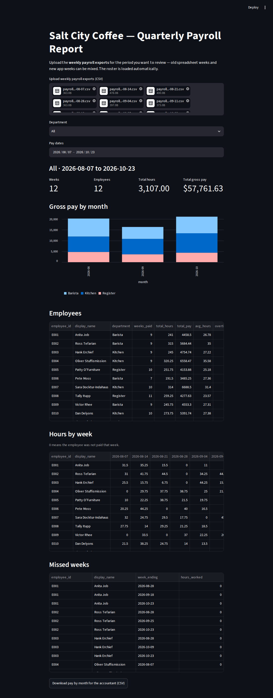

# IST356 Assignment 05 — The Quarter in Review

It's the end of October at **Salt City Coffee**, and the weekly payroll app you built
in Assignment 04 has been running since September. Every Friday the office manager
uploads the timesheet and downloads the payroll export — `payrolldate, employeeid,
hours, rate, total` — for the online payroll provider. Before the app, she typed that
same file into a spreadsheet by hand. So there's a folder with a quarter of history in
it: twelve weekly exports, seven of them hand-typed and five from your app.

Now everyone has a question the weekly page can't answer. The **owner** wants to know
where the hours went this quarter, and who's been working overtime. The **accountant**
wants gross pay by month and department, as a CSV. And the **office manager** wants
to see who has been missing shifts. Each answer means looking at many weeks at once —
and the hand-typed weeks are a mess: dates like `"8/14/2026"`, IDs like `" e004"` and
`"E4"`, money like `"$1,029.00"`.

You're going to build the page that answers all three. Behind it is the next stage of
the pipeline, and it uses the rest of unit 3:

- **Strings and dates** (lesson 3-6) — clean a whole column at once with `.str`, and
  turn text into real dates with `pd.to_datetime` and `.dt`.
- **Group by** (lesson 3-5) — go from *one row per person per week* to *one row per
  person*.
- **Pivot and melt** (lesson 3-5) — turn long tables wide for people to read, and back
  to long again to find the weeks nobody was paid.

Assignment 04's lineage rule still holds for every step that widens the history. The
new idea this week is **grain**: a group-by or a pivot doesn't widen a table, it builds
a *new* one at a different grain. That's allowed — as long as the history it was built
from is left untouched.

## Meta

### Learning Objectives

By the end of this assignment you will be able to:

1. **Clean a whole column with vectorized `.str` methods** (`strip`, `upper`, `zfill`, `replace`, `split`) instead of `apply`
2. **Convert text to numbers with `pd.to_numeric(errors="coerce")`** and fill what couldn't be read
3. **Parse dates with `pd.to_datetime`**, naming the `format=` and coercing anything unreadable to `NaT`, even when a column mixes two formats
4. **Use the `.dt` accessor** to format dates as labels and to filter by date
5. **Stack many files into one DataFrame with `pd.concat`**, and explain what `ignore_index=True` prevents
6. **Explain grain** — what one row stands for — and tell a step that widens a table from one that changes its grain
7. **Summarize with `groupby` and named aggregation**, including a lambda, and bring the keys back with `reset_index`
8. **Reshape long to wide with `pivot_table`** (`fill_value=0`) and **wide to long with `melt`**
9. **Use the pivot-then-melt round trip** to make rows that don't exist in the source — the weeks someone *wasn't* paid
10. **Build a multi-file Streamlit report** with filters (`st.selectbox`, `st.date_input`), metrics, a bar chart and a download
11. **Read three kinds of tests** — unit, pipeline (lineage and grain), and structure — and know which one to look at when something fails

### Assignment Layout

- `code/` — **where you write code.** Only files in this folder are reviewed for grading.
  - `payroll/` — the **pipeline package**
    - `__init__.py` — **provided.** Declares the package's public API
    - `extract.py` — **provided.** Loads the roster and the exports; generates histories for the tests
    - `history.py` — **Step 1, you write this.** Combine the weeks, clean text and dates (walked through line by line)
    - `summarize.py` — **Step 2, you write this.** Add the roster, then group by employee (the steps described, the code yours)
    - `reshape.py` — **Step 3, you write this.** `pivot_table` and `melt` (**on your own**)
  - `payroll_report_app.py` — the **Streamlit page** that puts it all together (**on your own**)
  - `explore.py` — **provided.** Runs the pipeline one step at a time so you can debug it
  - `reflection.txt` — **where you write your reflection** (graded)
- `data/` — `employees.csv` (the roster) and `exports/` (twelve weekly payroll exports, 2026-08-07 to 2026-10-23)
- `tests/` — the automated tests
  - `test_unit.py` — **Unit Tests** for the four Series functions
  - `test_pipeline.py` — **Pipeline & App Tests**: lineage and grain on every step, the real quarter, the page
  - `test_code.py` — **Code Structure Tests**: how it was built — `.str`, `to_datetime`, `groupby`, `pivot_table`, `melt`, the lineage rule
- `grader/` — the autograder used by GraderThan (you don't touch this)
- `.devcontainer/` — configures the pre-built course dev container (`mafudge/ist356:latest`)
- `.streamlit/` / `.vscode/` — Streamlit settings and run / debug / test configurations
- `README.md` — these instructions
- `reflection.md` — how to write a good reflection
- `rubric.json` / `requirements.txt` — grading rubric and Python dependencies
- `ruff.toml` — the code style rules the grader checks (`ruff check`, [Reference #14](#14-how-do-i-check-my-code-style))
- `payroll_report_app.png` — a screenshot of the finished app

You write **thirteen functions** across three modules — most are a few lines — and **one
Streamlit page**. `extract.py`, `__init__.py` and `explore.py` are given; read them, but
don't change them.

### Prerequisites

Same environment as Assignments 01–04. pandas and Streamlit are already in the course
container; `requirements.txt` asks for `streamlit>=1.56` because the app tests use
Streamlit's testing module, and the container installs it when it first builds.

If you haven't done the one-time course setup yet:

👉 https://mafudge.github.io/ist356/0-intro/0-0-setup.html

> **No computer setup? Use GitHub Codespaces** to run everything in your browser — you
> only need a GitHub account.

---

## Prep — Open the assignment

Same as before: **first fork, then** pick **one** of two ways to open your fork in the
course environment.

1. **Fork this repository.** At the top-right of this repo's GitHub page, click
   **Fork**. This makes your own personal copy under your GitHub account. You submit
   and are graded on *your fork* — work done anywhere else cannot be graded.

Now choose **Option A** (in the browser — nothing to install) **or** **Option B** (on
your own computer). Everything in the Walkthrough works the same either way.

### Option A — GitHub Codespaces (in the browser) ⭐ easiest

1. Go to **your fork's** page on GitHub. Click the green **Code** button, then the
   **Codespaces** tab.
2. Click **Create codespace on main**. The container builds (the first time takes a few
   minutes) and installs this assignment's dependencies for you.
3. VS Code opens in your browser, already **inside the course container**, with your
   fork's code loaded and Git signed in. You can skip cloning — you're ready.

> Reopen an existing Codespace anytime from **https://github.com/codespaces**. Codespaces
> have monthly free hours, so **stop** yours when you're done: `github.com/codespaces` →
> **⋯ → Stop codespace**.

### Option B — Your own computer (local dev container)

Requires Docker Desktop and VS Code from the [course setup](https://mafudge.github.io/ist356/0-intro/0-0-setup.html).

1. **Clone your fork.** On your fork's page, click the green **Code** button and copy
   the HTTPS URL, then clone it: `Ctrl+Shift+P` → **Git: Clone**, paste the URL, pick a
   folder. Or from a terminal:

   ```sh
   git clone https://github.com/YOUR-GITHUB-USERNAME/assignment_05.git
   ```

   > Make sure the URL has **your** username in it, not `ist356`.

2. **Open the folder and reopen in the container.** **File → Open Folder** → the cloned
   `assignment_05` folder → click **Reopen in Container** when VS Code offers it
   (or `Ctrl+Shift+P` → **Dev Containers: Reopen in Container**).

### Check you're ready

Open the **Testing** panel (View → Testing) and run the tests
([Reference #8](#8-how-do-i-run-automated-tests)). You should see **0 passing and 65
failing** — that is exactly right. Every test is about a function you haven't written
yet. All red is the correct starting line. (Many of those 65 are the same unit test run
on different inputs, so the count drops fast once a function works.)

If instead you see *no tests at all*, that is a different problem — see
[Reference #8](#8-how-do-i-run-automated-tests).

---

## About the data — read this before you start

| file | one row per | columns |
| --- | --- | --- |
| `data/employees.csv` | **person** (12 of them) | `employee_id` (`"E004"`), `name` (`"Moss, Pete"`), `department`, `hourly_rate` |
| `data/exports/payroll_<date>.csv` | **person paid that week** (8–12 rows) | `payrolldate`, `employeeid`, `hours`, `rate`, `total` |

`load_export` adds a sixth column to every export, `source_file`, so each row
remembers which week's file it came from.

HR's new system writes names **last name first**. The exports come in two styles:

| column | old spreadsheet (2026-08-07 to 09-18) | Assignment 04 app (2026-09-25 on) |
| --- | --- | --- |
| `payrolldate` | `"08/14/2026"`, `"8/14/2026"` | `"2026-09-25"` |
| `employeeid` | `"E004"`, `"e004"`, `" E004"`, `"E4"`, `"e4 "` | `"E004"` |
| `hours` | `"35.25"`, `" 35.25"`, `"35.00"` | `"35.25"` |
| `rate`, `total` | `"$18.50"`, `"$1,013.25"` | `"18.5"`, `"1013.25"` |

`extract.py` reads every value as **text** — that is deliberate. Your Step 1 functions
have to read every spelling in that table, and the rule from Assignment 02 still holds:
**coerce and carry on.** Unreadable money is `0.0`; an unreadable date is `NaT`.

**Generated histories.** `extract.py` also has `generate_history(seed)`: a made-up run of
4–7 weekly exports, old style then new, the same every time for the same seed. The
pipeline tests run your code on several seeds — there is no version of "make the test
pass" that isn't "actually write the function."

**The real quarter, for checking your work:** 113 rows across 12 weeks, every row
matching the roster, **3,107.00 hours** and **$57,761.63** in gross pay.

---

## Walkthrough — Do the assignment step by step

Work in order. Each step tells you *what* to do; when you need the *mechanics*, follow
the link to the matching **Reference — How do I…?** entry below.

### The training wheels come off

| module | what you get |
| --- | --- |
| `history.py` — Step 1 | every function's docstring ends with a **How to build it** that is nearly line by line |
| `summarize.py` — Step 2 | docstrings describe the steps in words; the code is yours |
| `reshape.py` — Step 3 | docstrings state the contract and nothing else |
| `payroll_report_app.py` | the goal, the widgets, the exact labels — and Assignments 03 and 04 beside you |

### Build order at a glance

| order | write this | turns green |
| --- | --- | --- |
| 1 | `clean_employee_id`, `clean_number`, `parse_pay_date` | `test_unit.py` — all but `format_name` |
| 2 | `combine_exports`, `add_clean_columns`, `add_date_parts` | `test_pipeline.py -k "combine or clean or date_parts"` |
| 3 | `format_name`, `add_roster`, `build_history` | `test_unit.py -k format_name`, `test_pipeline.py -k "roster or build or generated"` |
| 4 | `summarize_employees` | `test_pipeline.py -k summarize` |
| 5 | `hours_grid`, `missed_weeks`, `pay_by_month` | `test_pipeline.py -k "grid or missed or month"` |
| 6 | `payroll_report_app.py` | `test_pipeline.py -k app` |
| 7 | *(structure checks go green along the way)* | `test_code.py` |
| 8 | `reflection.txt` | — |

Every DataFrame test is **scoped**: `test_summarize_employees_values` hands the function
a small history that is already clean, so it passes when *that* function works — even if
Step 1 is still broken. When a scoped test passes but a `real_quarter` test fails, the
function is fine and something upstream is feeding it bad data.

### Step 1 — Read what you've been given

Open `code/payroll/extract.py` and run it (**Python Debugger: Current File**). It prints
the roster, an old-spreadsheet week, an app week and a generated week. Look at
`employeeid`. Look at `payrolldate`. You cannot clean what you have not seen.

Then open `code/explore.py`. It runs the pipeline one step at a time on the real quarter
and prints what each step returns — and stops, politely, at the first function you
haven't written. Run it after every function you finish
([Reference #9](#9-how-do-i-debug-a-pipeline-step)).

### Step 2 — Part 1: `history.py`, a quarter of text into one clean table

1. **`clean_employee_id`, `clean_number`, `parse_pay_date`** — three Series functions:
   a whole column in, a whole column out. Follow each *How to build it*. They are
   `.str` and `pd.to_datetime` instead of `apply` — [Reference #2](#2-how-do-i-clean-a-whole-column-with-str)
   and [Reference #3](#3-how-do-i-parse-dates-and-what-is-nat). The trap in
   `clean_employee_id` is `"E4"`: uppercase isn't enough, it has to become `"E004"`.
2. **`combine_exports`** — one `pd.concat`. Don't skip `ignore_index=True`
   ([Reference #4](#4-how-do-i-stack-many-files-into-one-dataframe)).
3. **`add_clean_columns`** and **`add_date_parts`** — Assignment 04's copy-add-return
   shape, one new column per line. The raw columns stay exactly as typed.

Run `pytest tests/test_unit.py` and `pytest tests/test_pipeline.py -k "combine or clean or date_parts"`.

### Step 3 — Commit and get early feedback

Commit `step 1: history` ([Reference #10](#10-how-do-i-commit-my-changes-in-vs-code)),
push, and submit to GraderThan ([Reference #13](#13-how-do-i-submit-for-grading--and-review-my-feedback--with-graderthan)).
See what partial credit looks like and read the style feedback while there's time to act
on it.

### Step 4 — Part 2: `summarize.py`, the roster on, then one row per person

1. **`format_name`** — `"Moss, Pete"` → `"Pete Moss"` with `.str.split(",")`. Watch
   for the name with no space after the comma.
2. **`add_roster`** — the same one-sided merge as Assignment 04, with the roster cut
   down to the three columns the history needs. It only matches if `clean_employee_id`
   did its job: run `explore.py` and look for `NaN` in `department`.
3. **`build_history`** — chain the four row-level steps. Then run
   `pytest tests/test_pipeline.py -k "build or generated"`: these are the tests that run
   your whole pipeline on the real quarter and on histories it has never seen.
4. **`summarize_employees`** — your first group-by. Group on the three identity
   columns, compute five numbers per group with **named aggregation**, `reset_index()`,
   sort ([Reference #5](#5-how-do-i-group-by-and-name-the-results)). The overtime count
   needs a lambda.

### Step 5 — Commit

Commit `step 2: summarize`, push, submit.

### Step 6 — Part 3: `reshape.py` *(on your own)*

Three functions, and the docstrings are the whole spec
([Reference #6](#6-how-do-i-pivot-and-melt)):

- **`hours_grid`** — employees down the side, one column per week, hours in the cells,
  **0** where someone wasn't paid.
- **`missed_weeks`** — melt that grid back to rows and keep the zeros. That's the only
  way to see an absence: no export has a row for someone who didn't work.
- **`pay_by_month`** — months down the side, departments across the top. It's the
  accountant's CSV *and* the shape `st.bar_chart` wants.

Check against the real quarter: 31 missed (employee, week) pairs; September's Kitchen
pay is $7,172.27.

### Step 7 — Commit

Commit `step 3: reshape`, push, submit. The pipeline is done; everything below is the
page.

### Step 8 — The app: `payroll_report_app.py` *(on your own)*

| widget | key | shows |
| --- | --- | --- |
| `st.title` | | `Salt City Coffee — Quarterly Payroll Report` |
| `st.file_uploader` | `exports` | `accept_multiple_files=True`; the roster comes from `load_employees()` |
| `st.warning` | | only if some rows have no `department` — and it names their `employeeid`s; those rows are left out of everything below |
| `st.selectbox` | `department` | `"All"` plus each department |
| `st.date_input` | `dates` | a `(start, end)` range, defaulting to the first and last pay date |
| `st.metric` ×4 | | `Weeks`, `Employees`, `Total hours` (as `3,107.00`), `Total gross pay` (as `$57,761.63`) |
| `st.bar_chart` | | `pay_by_month(...)` with `x="month"` |
| `st.dataframe` ×3 | | `summarize_employees(...)`, `hours_grid(...)`, `missed_weeks(...)` |
| `st.download_button` | `download` | `pay_by_month(...)` as CSV, for the accountant |

Every report uses the **filtered** history: the rows in the chosen department (or all)
whose `pay_date` is in the chosen range. Nothing below the uploader appears until files
are chosen. The new widgets are in [Reference #7](#7-how-do-i-take-many-files-a-date-range-and-draw-a-bar-chart).

Upload all twelve files from `data/exports/` (select them all in the file dialog) and
compare with the screenshot: 12 weeks, 12 employees, 3,107.00 hours, $57,761.63. Pick
**Kitchen** and narrow the dates to September: 4 weeks, 354.50 hours, $7,172.27.



Make `pytest tests/test_pipeline.py -k app` pass, then run the whole suite.

### Step 9 — Commit

Commit `report app`, push, submit.

### Step 10 — Write your reflection

Read `reflection.md`, then write yours in `code/reflection.txt`. Be **specific**, use the
**terminology** from this assignment (grain, long vs. wide, vectorized `.str` methods,
coerce, `NaT`, `pd.to_datetime` format, `.dt`, `concat`, `ignore_index`, group by, named
aggregation, `reset_index`, `pivot_table`, `fill_value`, `melt`, lineage), and make it
**actionable**.

### Step 11 — Final submit

Commit `assignment complete`, push, and submit again. Read your feedback and fix
anything flagged — you get multiple attempts before the due date.

---
## Reference — How do I…?

### 1. Lineage or grain — which rule applies to which step?

| step returns… | example | the rule |
| --- | --- | --- |
| the **same rows, more columns** | `add_clean_columns`, `add_date_parts`, `add_roster` | **lineage** (Assignment 04): copy, add, return; never overwrite, drop, rename, or modify the caller's frame |
| a **new table at a new grain** | `summarize_employees`, `hours_grid`, `pay_by_month` | build it from the history, and **leave the history untouched** |

Grain is "what one row stands for." The history is one row per person per week; the
summary is one row per person; `pay_by_month` is one row per month. A group-by doesn't
destroy lineage — every number in the summary still traces to a group of history rows —
but it does start a new table, so there are no "input columns" to preserve. The tests
check both: `assert_lineage` for widening steps, `assert_unmodified` for everything.

### 2. How do I clean a whole column with `.str`?

`.str` is a doorway on a Series: any string method you put after it runs on **every
value** and returns a new Series, in the same order. No `apply`, no loop:

```python
ids.str.strip()                  # " e004" -> "e004"   (every value)
ids.str.strip().str.upper()      # chain them: "e004" -> "E004"
ids.str[1:]                      # slicing works too: "E4" -> "4"
digits.str.zfill(3)              # pad with zeros: "4" -> "004"
"E" + digits                     # a string plus a Series adds to every value
values.str.replace("$", "", regex=False)
names.str.split(",")             # every value becomes a list ...
names.str.split(",").str[0]      # ... and .str[0] takes item 0 of every list
```

`regex=False` tells `replace` to look for the literal character — in a regular
expression, `$` means "end of the line."

To turn the cleaned text into numbers, use `pd.to_numeric(cleaned, errors="coerce")`:
anything it can't read becomes `NaN` instead of an exception. Then `.fillna(0.0)`.

### 3. How do I parse dates, and what is `NaT`?

```python
pd.to_datetime(values, format="%m/%d/%Y", errors="coerce")
```

`format=` is a promise about *every* value: `%m/%d/%Y` reads `"08/14/2026"` and
`"8/14/2026"`; `%Y-%m-%d` reads `"2026-09-25"`. Anything that doesn't fit becomes
**`NaT`** ("not a time"), the date version of `NaN` — `pd.isna` finds both. A column with
two formats needs two passes, then `first.fillna(second)` to fill one result's holes from
the other.

Leave `format=` off and pandas *guesses*, and the guess for `"03/04/2026"` depends on the
computer. That's why the structure tests insist on a format.

Once a column is a real datetime, `.dt` is its doorway, the way `.str` is for text:

```python
history["pay_date"].dt.strftime("%Y-%m")   # "2026-08" for every row
history["pay_date"].dt.date                # plain dates, to compare with st.date_input
history["pay_date"].min()                  # dates sort and compare like numbers
```

### 4. How do I stack many files into one DataFrame?

```python
pd.concat(list_of_frames, ignore_index=True)
```

The frames go one under the other, matched by column name (lesson 3-3). Each weekly
export numbers its rows from 0, so without `ignore_index=True` the result has twelve row
0s — and `history.loc[0]` returns twelve rows instead of one.

### 5. How do I group by, and name the results?

```python
summary = (
    history.groupby(["employee_id", "display_name", "department"])
    .agg(
        weeks_paid=("week_ending", "count"),
        total_hours=("hours_worked", "sum"),
        ...
    )
    .reset_index()
)
```

Each keyword in `.agg` is a new column: `new_name=("column", "how")`, where `"how"` is
`"count"`, `"sum"`, `"mean"`, `"nunique"`, … or a function. A lambda receives **one
group's** values as a Series, so `lambda hours: (hours > 40.0).sum()` counts that
person's overtime weeks (`True` counts as 1).

The grouped columns end up in the **index** — `reset_index()` brings them back as
ordinary columns. And a row whose key is `NaN` is left out of every group, silently —
which is why the app warns about unmatched IDs before it summarizes anything.

### 6. How do I pivot and melt?

**Long → wide** with `pivot_table`: pick the column that goes down the side (`index=`),
the one that spreads across the top (`columns=`), the one in the cells (`values=`), and
how to combine duplicates (`aggfunc=`):

```python
history.pivot_table(index=["employee_id", "display_name"], columns="week_ending",
                    values="hours_worked", aggfunc="sum", fill_value=0)
```

`fill_value=0` puts a 0 where there was no row — otherwise it's `NaN`. Then
`reset_index()` to turn the index back into columns.

**Wide → long** with `melt`: the `id_vars=` columns stay put, and every other column
becomes a (`var_name`, `value_name`) pair, one row each:

```python
grid.melt(id_vars=["employee_id", "display_name"], var_name="week_ending", value_name="hours_worked")
```

The round trip is the trick in `missed_weeks`: the pivot *created* a cell for every
employee and week, so after melting there is a row — with 0 hours — for every week
someone wasn't paid. Lesson 3-6's polling challenge uses the same move to find absences.

### 7. How do I take many files, a date range, and draw a bar chart?

```python
uploads = st.file_uploader("...", type=["csv"], accept_multiple_files=True, key="exports")
```

returns a **list** of files (empty until some are chosen), so `if uploads:` works, and
`[load_export(u) for u in uploads]` loads them all.

```python
dates = st.date_input("Pay dates", value=(first, last), min_value=first, max_value=last, key="dates")
```

with a tuple `value` is a range picker. While the user is mid-pick it can return just
one date, so unpack carefully: `start, end = dates if len(dates) == 2 else (dates[0], dates[0])`.

```python
st.bar_chart(monthly, x="month")
```

draws one bar group per `month`, one color per remaining column — which is why
`pay_by_month` is wide.

### 8. How do I run automated tests?

Open **Testing** in the activity bar (View → Testing). Press ▶ next to a test to run it,
or ▶ at the top to run them all. Click a failed test to see the assertion, expected vs.
actual, and the line number.

From a terminal at the repository root:

```
pytest tests/test_unit.py -v
pytest tests/test_pipeline.py -k summarize     # one step at a time: combine, clean, roster, grid, app ...
pytest tests/test_code.py -v
```

**If the Testing panel shows no tests at all**, or `pytest` stops with
`ImportError ... payroll`: `payroll/__init__.py` imports every pipeline function by
name, so a function that does not exist (a deleted signature, a typo in a name) stops
the whole package from importing. Scroll up to the `ImportError`; it names the missing
function. If instead the error mentions `streamlit.testing`, run
`pip install -r requirements.txt`.

### 9. How do I debug a pipeline step?

Tests don't stop at breakpoints, but scripts do. Open `code/explore.py`, set a
breakpoint inside the function you're working on (in `history.py`, say), and run
`explore.py` with **Python Debugger: Current File**. When it stops, the **VARIABLES**
panel shows every DataFrame — expand one to see its columns and values. Without
breakpoints, `explore.py` just prints each step's result.

For the app, **Streamlit Run: Current File** is a real debug session too: set a
breakpoint, upload files in the browser, and VS Code stops there. See Assignment 03 for
opening the app (port **28502**, or the **PORTS** tab in Codespaces).

### 10. How do I commit my changes in VS Code?

View → Source Control. Type a commit message in the box, then click **Commit**. Commit
after each step — not once at the end.

### 11. How do I push my code to GitHub?

In Source Control, click **Sync Changes** (or the ⋯ menu → Push). In Codespaces you're
already signed in.

### 12. How do I see my code on GitHub?

Open your fork in the browser: `https://github.com/YOUR-GITHUB-USERNAME/assignment_05`.
If your latest change isn't there, it isn't pushed — and GraderThan won't see it.

### 13. How do I submit for grading — and review my feedback — with GraderThan?

GraderThan runs the autograder (unit, pipeline & app, and structure tests), the code
style checks ([Reference #14](#14-how-do-i-check-my-code-style)) and an AI reviewer
(reflection) against your fork, then gives you a score and per-criterion feedback.

**Submit:**

1. Go to **https://graderthan.cent-su.org** and log in with your SU Microsoft account.
2. On **Your dashboard**, click this assignment.
3. **First time only:** if you see **"Link your GitHub account first,"** click
   **Profile** → **Connect GitHub** and authorize it.
4. Under **Request grading**, submit your **fork's GitHub URL**
   (e.g. `https://github.com/YOUR-GITHUB-USERNAME/assignment_05`). Click **Submit for
   Grading and Feedback.**

> Always **commit and push before you submit** — GraderThan only sees what's on GitHub.
> You get multiple attempts, so submit early and often.

**Review your feedback:** scroll to **"Your submissions"** and click one. `AUTOMATED`
criteria show the raw test output (e.g. `26/26 tests passed`) with the names of any
failing tests; the code style criterion shows each of its four checks as met or
missed, with the file and line; `AI-JUDGED` criteria show a written paragraph and a
**"How to improve"** tip.

### 14. How do I check my code style?

The **Code style & readability** point is four checks on everything in `code/`, and
**all four** must pass:

| check | how to see it yourself |
| --- | --- |
| no `# TODO` comments left | search `code/` for `TODO` — the starter has one in every function you write; delete each once it's done |
| no leftover `pass` stubs | every `pass` the starter left where a body goes is replaced by your code |
| a docstring on every function | the starter's functions already have one; keep them, and give any helper you add its own |
| no lint errors | run `ruff check` in a terminal at the repository root — **no output means it passes** |

`ruff check` uses this repository's `ruff.toml`, which holds exactly the rules the
grader uses (pycodestyle + pyflakes, lines of at most 88 characters), so what you see is
what is graded. The Ruff extension also underlines the same problems in the editor, and
`ruff check --fix` repairs some of them for you.

On an untouched checkout, `ruff check` already reports three unused imports in
`summarize.py`. They're the Step 1 functions `build_history` is about to call — they go
away when you write it in Step 4. (Don't let `ruff check --fix` delete them: you need
those imports, you just haven't used them yet.)

---
## The Assignment — what to actually do

### 1. The pipeline — `code/payroll/`

`extract.py` and `__init__.py` are provided. You write the thirteen functions below.

| module | function | returns |
| --- | --- | --- |
| `history.py` | `clean_employee_id(ids)` | a Series of `"E004"`-style IDs |
| | `clean_number(values)` | a Series of floats; `0.0` where unreadable |
| | `parse_pay_date(values)` | a datetime Series, either format; `NaT` where unreadable |
| | `combine_exports(exports)` | every row of every export, one fresh index |
| | `add_clean_columns(history)` | a copy with `employee_id`, `pay_date`, `hours_worked`, `rate_usd`, `gross_pay` added |
| | `add_date_parts(history)` | a copy with `week_ending` and `month` added |
| `summarize.py` | `format_name(names)` | a Series of `"First Last"` names |
| | `add_roster(history, employees)` | the history with `display_name` and `department` added; unknown IDs get `NaN` |
| | `build_history(exports, employees)` | raw exports in, finished history out — the four steps chained |
| | `summarize_employees(history)` | one row per employee: weeks, hours, pay, average, overtime weeks |
| `reshape.py` | `hours_grid(history)` | employees × weeks, hours in the cells, 0 for a missed week |
| | `missed_weeks(grid)` | one row per (employee, week) with zero hours |
| | `pay_by_month(history)` | months × departments, gross pay in the cells |

### 2. The page — `code/payroll_report_app.py`

Upload a quarter of exports; filter by department and dates; see four metrics, a bar
chart of pay by month, the employee summary, the hours grid and the missed weeks; and
download the accountant's CSV — exactly as specified in
[Step 8](#step-8--the-app-payroll_report_apppy-on-your-own).

### 3. Reflection

Read `reflection.md`, then write your reflection in `code/reflection.txt`.

---
## How You're Graded

GraderThan scores this assignment out of **10 points** (see `rubric.json`):

| What | Points | Judged by |
| --- | --- | --- |
| **Unit Tests** — `test_unit.py` (the four Series functions) | 2 | automated tests |
| **Pipeline & App Tests** — `test_pipeline.py` (lineage and grain on every step, the real quarter, generated histories, the page) | 3 | automated tests |
| **Code Structure Tests** — `test_code.py` (`.str`, `to_datetime`, `groupby`, `pivot_table`, `melt`, the lineage rule) | 2 | automated tests |
| **Code style & readability** — no `# TODO`s, no leftover `pass`, a docstring on every function, `ruff check` clean ([Reference #14](#14-how-do-i-check-my-code-style)) | 1 | automated style checks |
| Reflection quality | 2 | AI reviewer |

**Only files in the `code/` folder are graded.** Commit, push, and submit
([Reference #10–13](#10-how-do-i-commit-my-changes-in-vs-code)) to get your score and
feedback.
